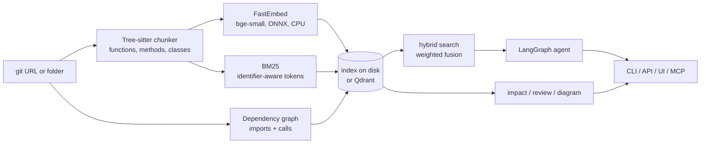
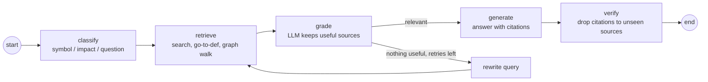

# CodeoGraph

**Grounded answers about any codebase - with citations, change impact and PR review - from Python, a CLI, a REST
API, a Streamlit UI or any MCP client (Claude Code, Claude Desktop, Cursor).**

[](https://github.com/dhruvg0ya1/CodeoGraph/actions/workflows/ci.yml)
[](https://github.com/dhruvg0ya1/CodeoGraph/actions/workflows/evals.yml)

**Live demo: [codeograph.streamlit.app](https://codeograph.streamlit.app)** - psf/requests and CodeoGraph itself are
indexed; ask, search, trace change impact, review a diff or add any public repository.

Most "chat with your repo" tools cut files into fixed-size text and hope the right piece comes back. CodeoGraph
parses the code, so every function, method and class is its own unit; searches it two ways at once; knows who calls
what; and answers only from code it can point to by file and line.

- **AST chunks** - Tree-sitter splits Python, JavaScript and TypeScript into functions, methods (`Session.send`) and
  classes, with signatures and docstrings. Every other language is indexed in overlapping line windows.
- **Hybrid search** - BM25 over identifier-aware tokens (`getUserById` -> get, user, by, id) plus dense vectors,
  fused by score (Reciprocal Rank Fusion and cross-encoder reranking are options). The defaults were picked by the
  benchmark below, not by habit. Embeddings run locally (FastEmbed / ONNX): **no API key and no per-call cost** to
  index or search.
- **Dependency graph** - imports resolved to files (absolute and relative), calls resolved through imports, `self`
  and typed variables. "What breaks if I change X" is a reverse walk with hop distance and a risk rating.
- **A LangGraph agent** - classifies the question, retrieves, grades what it found, rewrites the query when nothing
  is relevant, answers with `[n]` citations, then verifies every citation points at a retrieved source.
  Conversation memory per thread.
- **An MCP server** - 9 tools (index, search, go-to-definition, read file, impact, diff review, diagram, list, ask)
  so Claude or Cursor can work from your real code. None of them needs an API key.
- **PR review** - a diff is mapped onto the index by exact line overlap, so the review knows which functions changed
  and which code outside the diff depends on them.
- **Measured, in CI** - a retrieval benchmark gates every change to the code; the agent's answers are scored with
  RAGAS every week.
- **Incremental** - unchanged commits are skipped and unchanged functions keep their vectors on re-index.

## Results

### Retrieval
<!-- RETRIEVAL_EVAL:START -->
| Retrieval | Recall@1 | Recall@5 | Recall@10 | MRR@10 | nDCG@10 | p50 latency |
|---|---|---|---|---|---|---|
| BM25 only | 0.40 | 0.75 | 0.80 | 0.537 | 0.565 | 0 ms |
| Dense only | 0.62 | 0.88 | 0.95 | 0.729 | 0.745 | 6 ms |
| **Hybrid, weighted 0.5 / 0.5** | 0.68 | 0.90 | 0.95 | **0.772** | 0.775 | 6 ms |
| Hybrid, weighted 0.6 dense / 0.4 BM25 (default) | 0.68 | 0.93 | 0.93 | 0.760 | 0.763 | 6 ms |
| Hybrid, weighted 0.7 / 0.3 | 0.68 | 0.93 | 0.93 | 0.757 | 0.757 | 6 ms |
| Hybrid, RRF | 0.62 | 0.90 | 0.97 | 0.728 | 0.750 | 7 ms |
| Hybrid, RRF + MS MARCO cross-encoder | 0.62 | 0.80 | 0.93 | 0.719 | 0.713 | 1488 ms |

40 questions on [`requests` v2.32.3](https://github.com/psf/requests/tree/v2.32.3) (695 chunks), embedder `BAAI/bge-small-en-v1.5` on a GitHub Actions CPU runner. Reproduce: `python evals/retrieval_eval.py`.
<!-- RETRIEVAL_EVAL:END -->

### Answers
<!-- ANSWER_EVAL:START -->
| Metric | Value |
|---|---|
| Answers that cite the expected function | 70% |
| Answers with at least one valid citation | 100% |
| Citations removed by the verify step | 0 |
| RAGAS faithfulness | 0.188 |
| RAGAS context precision | 1.000 |
| Median time per answer | 124.9 s |

10 questions from the retrieval set, answered by the agent with `openai:qwen2.5:3b`, which also judges the RAGAS metrics (4 answers scored). Reproduce: `python evals/answer_eval.py`.
<!-- ANSWER_EVAL:END -->

What the benchmark changed: the generic MS MARCO cross-encoder, which usually helps prose search, made code search
worse here (added to RRF it took Recall@5 from 0.90 to 0.80) and cost over a second a query on CPU, so reranking is off by default; and plain
score-weighted fusion edged out Reciprocal Rank Fusion on MRR, so it is the default. How these are measured is in
[Evaluation](#evaluation).

## Quick start

```bash
pip install "git+https://github.com/dhruvg0ya1/CodeoGraph"        # Python 3.11+

codeograph index https://github.com/psf/requests                 # or a local folder
codeograph search psf-requests "how are redirects followed"
codeograph symbol psf-requests Session.send
codeograph impact psf-requests merge_environment_settings
codeograph ask    psf-requests "where is the proxy chosen for a URL?"
git diff | codeograph review psf-requests -
```

Indexing and search need nothing else. Answers and LLM-written reviews need one model - pick any (copy
`.env.example` to `.env`; `GOOGLE_API_KEY` is already there, empty):

| `CODEOGRAPH_LLM` | Set | Notes |
|---|---|---|
| `gemini` | `GOOGLE_API_KEY` | free tier works; `GEMINI_MODEL` (default `gemini-2.5-flash`); `pip install "codeograph[gemini]"` |
| `openai` | `OPENAI_BASE_URL`, `OPENAI_API_KEY` | OpenAI or any OpenAI-compatible server: vLLM, Ollama, LM Studio, OpenRouter, Groq; `OPENAI_MODEL` |
| `auto` (default) | - | Gemini if `GOOGLE_API_KEY`, else OpenAI-compatible if set, else no LLM |

With no LLM, the agent still runs and answers extractively: the best matching functions with their locations.

```bash
# a local model through Ollama (OpenAI-compatible endpoint)
export CODEOGRAPH_LLM=openai OPENAI_BASE_URL=http://localhost:11434/v1 OPENAI_MODEL=qwen2.5-coder:7b
```

### Use it from Claude Code, Claude Desktop or Cursor (MCP)

```bash
claude mcp add codeograph -- codeograph mcp
```

```json
{ "mcpServers": { "codeograph": { "command": "codeograph", "args": ["mcp"] } } }
```

Then ask your assistant to "index https://github.com/owner/repo with codeograph and find where X happens".

| Tool | What it returns |
|---|---|
| `index_repository` | indexes a URL or folder (incremental); returns the namespace |
| `list_repositories` | what is indexed, at which commit |
| `search_code` | hybrid search, filterable by file and kind (function, method, class, module, type) |
| `find_symbol` | go-to-definition, with code |
| `get_file` | a file or a line range from the indexed snapshot |
| `impact_analysis` | callers and importers, nearest first, with hops and risk |
| `review_diff` | changed functions, their dependents outside the diff, graph risk (+ LLM review if configured) |
| `architecture_diagram` | Mermaid diagram of file imports |
| `ask` | CodeoGraph's own agent (needs an LLM configured for CodeoGraph) |

### REST API and UI

```bash
codeograph serve --port 8000          # OpenAPI docs at http://localhost:8000/docs
pip install "codeograph[ui]" && streamlit run ui/app.py     # the UI starts its own API when BACKEND_URL is unset
```

The UI deploys as-is to Streamlit Community Cloud (main file `ui/app.py`; `ui/requirements.txt` installs the
package).

`POST /index`, `GET /index/status`, `POST /query` (streams the answer, then the cited sources), `POST /ask`,
`GET /search`, `GET /symbol`, `POST /impact`, `POST /review`, `GET /diagram`, `GET /repos`, `DELETE /repos/{ns}`,
`GET /health`.

## How it works



**The agent**



- `classify` is rules, not an LLM call: code identifiers in the question (`snake_case`, `camelCase`, `Dotted.name`,
  backticks) plus intent words decide between go-to-definition, an impact walk and a general search.
- `grade` and `rewrite` are a corrective-RAG loop (at most two rewrites).
- `verify` is deterministic: a `[n]` that does not point at a retrieved source is removed and reported; an answer
  that names a retrieved function in backticks instead of numbering it still gets that source as its citation.
- A LangGraph checkpointer keeps each thread's history, so follow-ups like "and who calls it?" work.

**Indexes** live in `~/.codeograph/indexes/<namespace>/` (chunks, vectors, graph, file snapshot) and survive
restarts. Vectors stay in the index folder (exact search, no locks, so the API, MCP server and CLI can share it) or
in a Qdrant server when `QDRANT_URL` is set (`pip install "codeograph[qdrant]"`).

## Evaluation

`evals/retrieval_eval.py` - 40 hand-written questions about [psf/requests](https://github.com/psf/requests)
v2.32.3, each with the function(s) that answer it. Most describe behaviour in plain English ("how does it decide
to drop the Authorization header on a redirect to another host?") without naming the function. Every retrieval
configuration is scored on the same index (Recall@1/5/10, MRR@10, nDCG@10, latency); the default pipeline's
Recall@5 is a CI gate, so a change that makes search worse fails the build.

`evals/answer_eval.py` - runs the agent on 10 of those questions and scores each answer: does it cite the expected
function, does every answer carry a valid citation, how many citations the verify step removed, plus RAGAS
faithfulness and context precision. In CI the model is Qwen2.5 3B running on the runner's CPU through Ollama's
OpenAI-compatible endpoint (no key, no cost) - or Gemini when the repository has a `GOOGLE_API_KEY` secret.

The retrieval eval runs in [`evals.yml`](.github/workflows/evals.yml) on every change to the code, the answer eval
weekly and on demand; both write the tables above. The unit and integration tests (`pytest`) run on every push on Python 3.11 and 3.12 with a
download-free hash embedder and fake chat models, so they need no network or keys.

## Configuration

| Variable | Default | |
|---|---|---|
| `CODEOGRAPH_HOME` | `~/.codeograph` | indexes and downloaded models |
| `CODEOGRAPH_EMBED_MODEL` | `BAAI/bge-small-en-v1.5` | any FastEmbed text model, e.g. `jinaai/jina-embeddings-v2-base-code` |
| `CODEOGRAPH_FUSION` | `weighted` | or `rrf` (Reciprocal Rank Fusion) |
| `CODEOGRAPH_DENSE_WEIGHT` | `0.6` | dense share of the weighted score (BM25 gets the rest) |
| `CODEOGRAPH_RERANK_MODEL` | `none` | a FastEmbed cross-encoder, e.g. `Xenova/ms-marco-MiniLM-L-6-v2` (see Results) |
| `CODEOGRAPH_LLM` | `auto` | `gemini`, `openai`, `none` |
| `QDRANT_URL` / `QDRANT_API_KEY` | - | store vectors in Qdrant instead of the index folder |

## Project layout

```
codeograph/   chunking, depgraph, embeddings, store, indexer, search, impact, review, diagram,
              llm, agent (LangGraph), mcp_server, api (FastAPI), cli
ui/app.py     Streamlit front end
evals/        retrieval + answer benchmarks, datasets, results
tests/        unit and integration tests on a small mixed-language fixture repo
```

## Limitations

- Call resolution is static and best-effort: dynamic dispatch, monkey-patching and calls through untyped
  variables are not followed, so impact analysis can miss dependents (it does not invent them).
- Symbol extraction covers Python, JavaScript and TypeScript; other languages are searched as line windows and
  have no call graph.
- In the answer eval, the judge is the same model that writes the answers, and in CI that is a small 3B model.

The [v1 demo video](https://www.youtube.com/watch?v=HWVfFtDU9rg) shows the original interface.

MIT licence - see [LICENSE](LICENSE).
